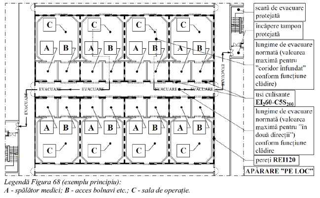

# Art. 3.2.4.9
(1) În cadrul construcțiilor civile de sănătate supraterane cu înălțimi obișnuite, se asigură separarea încăperilor de restul construcției potrivit prevederilor privind performanțele comune și cele specifice, iar atunci când norma nu dispune, prin pereți neportanți despărțitori interiori cu rol de limitare a propagării focului potrivit Art. 2.1.3.2. și Tabelul 2.
(2) În cadrul unor grupări de încăperi deschise (spații deschise de lucru pentru activități care necesită o comunicare frecventă) de tip open space care nu sunt utilizate de persoane care nu se pot evacua singure, definite conform terminologie (spații administrative precum și vestiarele personalului, incluse în funcțiunea de sănătate) cu suprafața maximă normată, cu risc mic de incendiu și aceeași destinație (proprie sau complementară/spații și circulații funcționale delimitate cu parapete, panouri sau pereții interiori despărțitori funcționali), se prevăd minimum pereți despărțitori de sectorizare cu rol de limitare a propagării focului față de spațiile adiacente (cu excepția celor către căile de evacuare care respectă prevederile specifice și a celor către încăperi cu risc mai mare generat de densitatea sarcinii termice din încăperi adiacente), care trebuie să fie clasa de reacție la foc A1 sau A2-s1,d0 minimum:
  - a) EI/REI 120 prevăzuți cu uși rezistente la foc și etanșe la fum EI_2 60-C5S_200 în construcțiile civile de sănătate supraterane cu înălțimi obișnuite, cu nivelul de stabilitate la incendiu I;
  - b) EI/REI 90 prevăzuți cu uși rezistente la foc și etanșe la fum EI_2 45-C5S_200 în construcțiile civile de sănătate supraterane cu înălțimi obișnuite, cu nivelul de stabilitate la incendiu II;
  - c) EI/REI 60 prevăzuți cu uși etanșe la foc și etanșe la fum E 30-C5S_a în construcțiile civile de sănătate supraterane cu înălțimi obișnuite, cu nivelul de stabilitate la incendiu III;
  - d) EI/REI 30 prevăzuți cu uși etanșe la foc și etanșe la fum E 15-C5S_a în construcțiile civile de sănătate supraterane cu înălțimi obișnuite, cu nivelul de stabilitate la incendiu IV;
  - e) EI/REI 15 prevăzuți cu uși C5 în construcțiile civile de sănătate supraterane cu înălțimi obișnuite, cu nivelul de stabilitate la incendiu V.
(3) Grupările de încăperi cu risc mic de incendiu și aceeași destinație, incluzând și destinații colaterale, inclusiv cele de comunicări funcționale orizontale (precum vestiare + grupuri sanitare; birouri + sas acces) precum și cele specifice funcțiunii de sănătate (camera RMN + camera de comandă + sas acces; cameră CT+ cameră de comandă + sas acces etc.) compartimentate între ele cu panouri opace sau vitrate, fixe sau mobile folosite ca separări funcționale și/sau izolante fonic sau pereți interiori despărțitori funcționali, se admit în limita următoarelor arii construite în cadrul construcțiilor de sănătate cu înălțimi obișnuite:
  - – maximum 600 mp, cu condiția ca aria construită a încăperilor de tip open space să fie de maximum 50% din cea a ariei construite a nivelului clădirii/compartimentului de incendiu respectiv, pentru construcții de sănătate încadrate în nivelul I de stabilitate la incendiu;
  - – maximum 400 mp, cu condiția ca aria construită a încăperilor de tip open space să fie de maximum 50% din cea a ariei construite a nivelului clădirii/compartimentului de incendiu respectiv pentru construcții de sănătate încadrate în nivelul II de stabilitate la incendiu;
  - – maximum 200 mp, cu condiția ca aria construită a încăperilor de tip open space să fie de maximum 50% din cea a ariei construite a nivelului clădirii/compartimentului de incendiu respectiv pentru construcții de sănătate încadrate în nivelul III de stabilitate la incendiu;
  - – maximum 100 mp, cu condiția ca aria construită a încăperilor de tip open space să fie de maximum 25% din cea a ariei construite a nivelului clădirii/compartimentului de incendiu respectiv pentru construcții de sănătate încadrate în nivelul IV de stabilitate la incendiu;
  - – maximum 50 mp, cu condiția ca aria construită a încăperilor de tip open space să fie de maximum 25% din cea a ariei construite a nivelului respectiv pentru construcții de sănătate încadrate în nivelul V de stabilitate la incendiu.
(4) La construcțiile de sănătate cu înălțimi obișnuite, echipate cu instalații de detectare, semnalizare și alarmare a incendiului cu acoperire totală, cu sisteme sau instalații de evacuare a fumului și instalații de stingere tip sprinkler, se admite majorarea ariilor construite ale grupărilor de încăperi prevăzute la alin. (3) cu 25%.
(5) Pereții despărțitori prevăzuți între grupările de încăperi menționate la alin. (3), precum și între acestea și alte spații ale clădirii (dispuși la limita față de circulațiile comune de evacuare - coridoare, degajamente protejate, încăperi tampon ventilate în suprapresiune, scări închise etc. precum și față de spații cu risc diferit de incendiu - conform densităților sarcinilor termice (q) din spațiile adiacente și/sau densităților sarcinilor termice (q) cele mai mari din spațiile pe care le despart și/sau cele cu risc diferit de incendiu provenit din funcțiune), vor avea clasa de reacție la foc A1 sau A2-s1,d0 și încadrarea privind rezistența la foc minimum (dacă densitatea sarcinii termice din spațiile adiacente nu generează performanțe mai mari) a pereților de sectorizare cu rol de limitare a propagării focului (de protecție contra incendiilor care limitează propagarea în interiorul compartimentelor de incendiu (REI/EI), conform încadrării construcției/compartimentului de incendiu în nivelul de stabilitate la incendiu precizate în Tabelul 2 nr. crt. 5.
(6) Spațiile de același tip utilizate de persoane care nu se pot evacua singure, situate în clădiri de sănătate (clădiri de spitale sau cu caracter spitalicesc - spitale, maternități, policlinici, staționare medicale, dispensare, centre medicale și de sănătate multifuncționale, clinici și unități medicale ambulatorii similare policlinicilor, centre medicale de diagnostic și tratament, aziluri sau cămine pentru bătrâni și persoane cu dizabilități, ospicii pentru alienați mintal, sanatorii etc.) constituite în grupări de încăperi deschise, nu sunt admise, cu excepțiile precizate.
(7) Încăperile de dormit sau spitalizare (saloane, rezerve, cabinete medicale etc.), cu excepția celor care necesită supraveghere permanentă (ATI, UPU etc.) nu se pot constitui în grupări de tip open-space, acestea trebuind să fie delimitate între ele prin minimum pereți neportanți despărțitori interiori cu rol de limitare a propagării focului (EI) conform încadrării construcției/compartimentului de incendiu în nivel de stabilitate (dacă funcțiunea sau densitatea sarcinii termice din spațiile adiacente nu generează performanțe mai mari).
(8) Obligatoriu camerele de operații împreună cu destinațiile colaterale ale acestora (spălătoare, depozite de mână, de instrumentar medical specific etc.) conform Figura 68, precum și spațiile care necesită supraveghere permanentă (ATI) și recomandabil altor încăperi (UPU etc.), se vor constitui fiecare în grupare de tip open space în limita suprafețelor precizate la Art. 3.2.4.9. alin. (3) și se prevăd cu pereți rezistenți la foc EI/REI 120 și uși (culisante) rezistente la foc cu autoînchidere EI_2 60-C5S_200.

  

  Figura 68 - Concept de apărare "pe loc "
