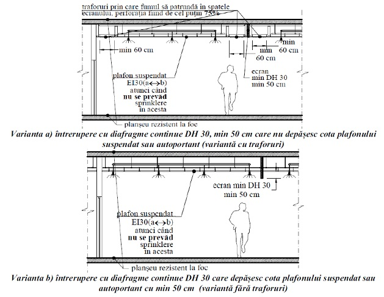
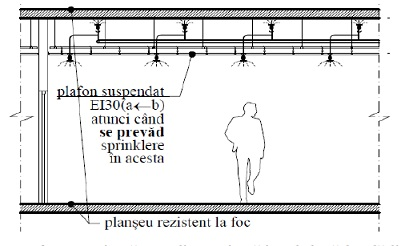

# Art. 4.1.4.3
(1) Plafoanele cu suprafața continuă sau discontinuă/modulară, de tip perforat, lamelar, fagure sau grătar (atât cele pline, cât și cele care nu sunt pline) din clădirile înalte se realizează din materiale încadrate în clasa de reacție la foc A1 sau A2-s1,d0. În plus plafoanele (autoportante sau suspendate) pline (cu suprafața continuă) vor fi rezistente la foc EI 30 (a←→b). Este obligatorie prevederea plafoanelor rezistente la foc EI 30 (a←b) pe căile comune de evacuare din clădirile înalte, atunci când spațiul dintre plafonul suspendat sau autoportant și planșeul de rezistență nu este echipat cu instalație automată de stingere cu sprinklere, sau a plafoanelor rezistente la foc EI 30 (a←b) pe căile comune de evacuare din clădirile înalte, atunci când spațiul dintre plafonul suspendat sau autoportant și planșeul de rezistență este echipat cu instalație automată de stingere cu sprinklere.
(2) În cazul plafoanelor pline (cu suprafața continuă închisă) suspendate sau autoportante, continuitatea spațiului dintre plafonul suspendat sau autoportant și planșeul de rezistență va fi întrerupt cu diafragme continue minimum DH 30, dispuse la maximum 30 m pe două direcții perpendiculare, atunci când spațiul dintre plafonul suspendat sau autoportant și planșeul de rezistență nu este echipat cu instalație automată de stingere cu sprinklere. În acest caz, plafoanele (autoportante sau suspendate) pline (cu suprafața continuă), vor fi rezistente la foc EI 30 (a←→b), conform Figura 70. În toate cazurile, se vor avea în vedere prevederile Art. 8.1.2.

  

  Figura 70 - Întrerupere cu diafragme a plafoanelor cu suprafața continuă sau discontinuă/ modulară la clădiri înalte (atunci când spațiul dintre plafonul suspendat sau autoportant și planșeul de rezistență nu este echipat cu instalație automată de stingere cu sprinklere conform SR EN 12845)
(3) În cazul plafoanelor pline (cu suprafața continuă închisă) suspendate sau autoportante, continuitatea spațiului dintre plafonul suspendat sau autoportant și planșeul de rezistență nu va fi întreruptă cu diafragme continue atunci când spațiul dintre plafonul suspendat sau autoportant și planșeul de rezistență este echipat cu instalație automată de stingere cu sprinklere. În acest caz plafoanele (autoportante sau suspendate) pline (cu suprafața continuă) vor fi rezistente la foc EI 30 (a←→b), conform Figura 71. În toate cazurile, se vor avea în vedere prevederile Art. 8.1.2.

  

  Figura 71 - Plafoane cu suprafața continuă sau discontinuă/modulară la clădiri înalte la care nu este necesară întreruperea cu diafragme (atunci când spațiul dintre plafonul suspendat sau autoportant și planșeul de rezistență este echipat cu instalație automată de stingere cu sprinklere conform SR EN 12845)
