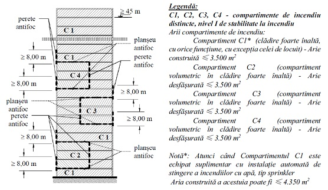

# Art. 4.2.2.1
(1) Comasarea între ele sau cu alte construcții civile foarte înalte în cadrul aceluiași compartiment de incendiu, este interzisă.
(2) Distanțele minime de siguranță la incendiu ce trebuie asigurate între clădiri civile supraterane foarte înalte și alte construcții, sunt stabilite conform normativului, în Art. 2.2.1.2. și Tabelul 4.
(3) Clădirile civile supraterane foarte înalte se pot compartimenta pe toată înălțimea lor cu pereți antifoc în limita ariei construite (Ac) de maximum 3.500 mp în oricâte compartimente de incendiu. În cadrul unui compartiment de incendiu al clădirii foarte înalte cu aria construită (Ac) de maximum 3.500 mp se pot prevedea maximum trei porțiuni volumetrice a acestuia (conform Figura 72 și Figura 9, varianta c)), cu aria totală desfășurată (Ad) a fiecărei porțiuni volumetrice de maximum 3.500 mp (fără posibilitatea de majorare), porțiuni constituite din unul până la trei niveluri construite succesive delimitate de planșee antifoc și după caz, pereți antifoc de compartimentul de incendiu în care sunt inserate.
(4) În condițiile în care compartimentele nu sunt echipate cu instalație automată de stingere a incendiilor cu apă tip sprinkler dar sunt echipate cu instalație de detectare, semnalizare și alarmare a incendiului cu acoperire totală, în cadrul unui compartiment de incendiu cu aria construită (Ac) de maximum 3.500 mp se poate prevedea o singură porțiune volumetrică a acestuia (conform Figura 9 Varianta a)), cu aria totală desfășurată (Ad) de maximum 2.500 mp (fără posibilitatea de majorare), porțiune constituită din unul până la trei niveluri construite succesive delimitate de planșee antifoc și după caz, pereți antifoc.

  

  Figura 72 - Compartimentare antifoc și arii compartimente de incendiu
  la clădirile și compartimentele de incendiu supraterane civile foarte înalte
(4) Ariile construite aferente clădirilor și compartimentelor de incendiu pe toată înălțimea lor normate la 3.500 mp, pot fi majorate cu 25% atunci când sunt echipate cu instalații de stingere a incendiilor cu apă, tip sprinkler suplimentar față de prevederile normativului de profil.
