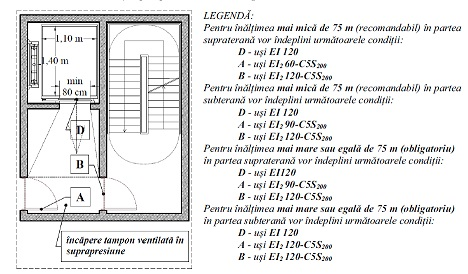

# Art. 4.2.4.15
(1) La clădirile foarte înalte este obligatorie prevederea a 2 (două) ascensoare de intervenție în caz de incendiu (de pompieri), cu acces facil de la nivelul intrării în clădire, realizate corespunzător cerințelor asigurării operațiunilor de intervenție în caz de incendiu și prevăzute cu apel prioritar pentru pompieri.
(2) Ascensoarele pentru intervenție în caz de incendiu, se prevăd cu puțuri proprii, separate între ele și atât față de restul clădirii cât și de exterior, cu pereți rezistenți la foc REI/EI 180 și, după caz, planșee rezistente la foc minimum REI 180, clasa de reacție la foc A1 sau A2-s1,d0 și goluri de acces protejate cu încăperi tampon de acces prevăzute cu ventilare în suprapresiune și uși rezistente la foc și etanșe la fum.
(3) Accesul la ascensoarele de intervenție la nivelurile supraterane ale clădirilor foarte înalte se asigură prin realizarea unor încăperi tampon ventilate în suprapresiune, prevăzute cu uși rezistente la foc și etanșe la fum EI_2 60-C5S_200 la clădiri cu înălțimea până la 75 m și EI_2 90-C5S_200 la clădiri cu înălțimea peste 75 m către circulațiile comune orizontale și uși rezistente la foc EI 120 la ușile ascensoarelor și încăperea tampon ventilată în suprapresiune trebuie să fie prevăzută cu pereți clasa de reacție la foc A1 sau A2-s1,d0, rezistenți la foc min EI/REI 120. Accesul la ascensoarele de intervenție la nivelurile subterane ale clădirilor civile înalte, se asigură prin realizarea unor încăperi tampon ventilate în suprapresiune, prevăzute cu uși rezistente la foc și etanșe la fum EI_2 90-C5S_200 la clădiri cu înălțimea până la 75 m și EI_2 120-C5S_200 la clădiri cu înălțimea peste 75 m către circulațiile comune orizontale și uși rezistente la foc EI 120 la ușile ascensoarelor și încăperea tampon ventilată în suprapresiune trebuie să fie prevăzută cu pereți clasa de reacție la foc A1 sau A2-s1,d0, rezistenți la foc min EI/REI 120.
(4) Ascensoarele pentru intervenție în caz de incendiu, vor respecta obligatoriu prevederile Art. 3.1.4.8. alin. (3) ÷ alin. (8) și prevederile Art. 3.1.4.8. alin. (11) ÷ alin. (14).
(5) Ascensoarele de intervenție în caz de incendiu trebuie să fie poziționate fiecare în cadrul construcțiilor astfel încât să fie prevăzute cu accese spre exterior direct din afară sau prin spații ferite de fum cu lungimea maximă echivalentă cu cea a dimensiunilor de coridor înfundat a clădirii foarte înalte.
(6) Ascensoarele pentru intervenție se prevăd cu apel prioritar pentru pompieri și vor asigura accesul pentru intervenție în caz de incendiu la nivelurile supraterane și subterane ale clădirii. La parcajele subterane cu mai mult de 4 niveluri înglobate în clădiri foarte înalte, ascensoarele pentru pompieri aferente parcajelor, trebuie să fie diferite față de ascensoarele pentru pompieri ale nivelurilor supraterane.
(7) Ascensoarele pentru intervenție se realizează potrivit prevederilor reglementărilor tehnice specifice și vor avea, fiecare, asigurată funcționarea timp de 120 de minute de la izbucnirea incendiului.
(8) Atunci când accesul pompierilor se face prin aceeași scară de evacuare (a persoanelor), la calculul fluxurilor de evacuare al persoanelor se consideră un flux de evacuare în minus pentru evacuarea acestora. Este obligatoriu ca lățimea liberă a rampelor și podestelor scării (măsurată conform prevederi normate) utilizabilă pentru un flux de evacuare persoane, precum și acces pompieri să fie în acest caz de minimum 1,20 m.
(9) La construcțiile cu înălțimea mai mare sau egală de 75 m se prevede obligatoriu ca cel puțin un ascensor de intervenție să fie prevăzut cu acces din încăperea tampon aferentă casei de scară destinată numai intervenției pompierilor, conform Figura 75.

  

  Figura 75 - Ascensor dedicat intervenției (obligatoriu la clădiri cu înălțimea mai mare sau egală de 75 m) prevăzut cu acces dedicat din încăperea tampon aferentă casei de scară destinată numai intervenției pompierilor
