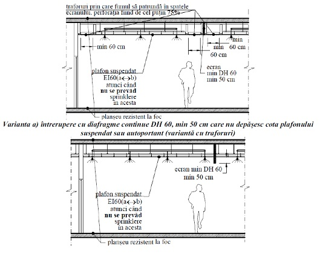
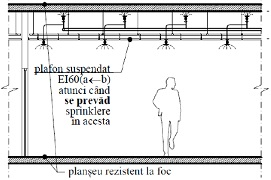

# Art. 4.2.4.3
(1) Plafoanele cu suprafața continuă sau discontinuă/modulară, de tip perforat, lamelar, fagure sau grătar (atât cele pline, cât și cele care nu sunt pline) din clădirile foarte înalte, se realizează din materiale încadrate în clasa de reacție la foc A1 sau A2-s1,d0. În plus plafoanele (autoportante sau suspendate) pline (cu suprafața continuă) vor fi rezistente la foc EI 60 (a←b). Este obligatorie prevederea plafoanelor rezistente la foc minimum EI 60 (a←→b) pe căile comune de evacuare din clădirile foarte înalte, atunci când spațiul dintre plafonul suspendat sau autoportant și planșeul de rezistență nu este echipat cu instalație automată de stingere cu sprinklere sau a plafoanelor rezistente la foc minimum EI 60 (a←b) pe căile comune de evacuare din clădirile foarte înalte atunci când spațiul dintre plafonul suspendat sau autoportant și planșeul de rezistență este echipat cu instalație automată de stingere cu sprinklere.
(2) În cazul plafoanelor pline (cu suprafața continuă închisă) suspendate sau autoportante, continuitatea spațiului dintre plafonul suspendat sau autoportant și planșeul de rezistență va fi întrerupt cu diafragme continue minimum DH 60, dispuse la maximum 30 m pe două direcții perpendiculare, atunci când spațiul dintre plafonul suspendat sau autoportant și planșeul de rezistență nu este echipat cu instalație automată de stingere cu sprinklere. În acest caz plafoanele (autoportante sau suspendate) pline (cu suprafața continuă) vor fi rezistente la foc EI 60 (a←→b), conform Figura 73. În toate cazurile se vor avea în vedere prevederile Art. 8.1.2.

  

  Varianta b) întrerupere cu diafragme continue DH 60 care depășesc cota plafonului suspendat sau autoportant cu min 50 cm (variantă fără traforuri)
  Figura 73 - Întrerupere cu diafragme a plafoanelor cu suprafața continuă sau discontinuă/modulară la clădiri foarte înalte (atunci când spațiul dintre plafonul suspendat sau autoportant și planșeul de rezistență nu este echipat cu instalație automată de stingere cu sprinklere conform SR EN 12845)
(3) În cazul plafoanelor pline (cu suprafața continuă închisă) suspendate sau autoportante, continuitatea spațiului dintre plafonul suspendat sau autoportant și planșeul de rezistență nu va fi întrerupt cu diafragme continue atunci când spațiul dintre plafonul suspendat sau autoportant și planșeul de rezistență este echipat cu instalație automată de stingere cu sprinklere. În acest caz plafoanele (autoportante sau suspendate) pline (cu suprafața continuă) vor fi rezistente la foc EI 60 (a←b), conform Figura 74. În toate cazurile se vor avea în vedere prevederile Art. 8.1.2.

  

  Figura 74 - Plafoane cu suprafața continuă sau discontinuă/modulară la clădiri foarte înalte la care nu este necesară întreruperea cu diafragme (atunci când spațiul dintre plafonul suspendat sau autoportant și planșeul de rezistență este echipat cu instalație automată de stingere cu sprinklere conform SR EN 12845)
