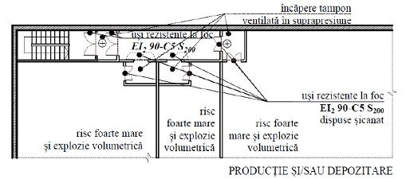

# Art. 6.1.5.8
Golurile de circulație dispuse în pereții de separare a circulațiilor comune orizontale din construcțiile de producție și/sau depozitare, se protejază corespunzător riscurilor de incendiu specifice încăperilor adiacente, respectiv cu uși etanșe sau rezistente la foc și etanșe la fum care asigură minimum:
a) E 15-C5S_200 la risc mic de incendiu;
b) EI_2 30-C5S_200 la risc mijlociu de incendiu;
c) EI_2 60-C5S_200 la risc mare de incendiu;
d) EI_2 90-C5S_200 la risc foarte mare de incendiu, respectiv încăperi tampon protejate, ventilate în suprapresiune și prevăzute cu uși rezistente la foc EI_(2)90-C5S_200 dispuse șicanat (Figura 76), la cele care sunt și cu risc de explozie volumetrică.

Figura 76 - Încăperi tampon protejate, ventilate în suprapresiune și prevăzute
cu uși rezistente la foc minimum EI_2 90-C5S_200 dispuse șicanat (la risc de explozie volumetrică)
