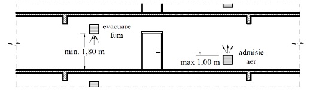

# Art. 8.1.10
(1) Evacuarea fumului și gazelor fierbinți în caz de incendiu trebuie să asigure circulația ascendentă a aerului în încăpere și evacuarea fumului în raport cu aerul introdus.
(2) Evacuarea fumului și gazelor fierbinți în caz de incendiu se asigură prin tiraj natural- organizat sau ventilare mecanică. Suprafața aerodinamică liberă a dispozitivelor cu deschidere automată pentru evacuarea fumului în caz de incendiu prin tiraj natural-organizat va fi cel puțin 1% din aria încăperii.
(3) Sistemul de evacuare a fumului și gazelor fierbinți în caz de incendiu se realizează prin prevederea gurilor de evacuare a fumului și gurilor de admisie a aerului proaspăt, dispuse alternat.
(4) Gurile de evacuare a fumului în caz de incendiu, alcătuite și dimensionate potrivit prevederilor normativului și ale reglementărilor tehnice de specialitate, se amplasează în treimea superioară a pereților încăperii, cu partea inferioară a grilei amplasată la minim 1,80 m față de pardoseală sau în acoperiș prevăzute în treimea superioară a șarpantei, raportată la înălțimea maximă a șarpantei. Gurile de evacuare a fumului pot comunica direct cu exteriorul sau prin canale (conducte rezistente la foc de evacuare a fumului) sau prin ghene de evacuare a fumului (Figura 78), luând în calcul pierderile de presiune pe tubulaturi și ghene.
(5) Introducerea aerului se realizează prin guri de admisie a aerului dispuse la partea inferioară (în treimea inferioară a pereților) a încăperilor/spațiilor prevăzute cu sistem de evacuare a fumului și a gazelor fierbinți în caz de incendiu, având marginea lor superioară la cel mult 1 m față de pardoseală pentru încăperi/spații cu înălțimea liberă de maxim 3 m, guri ce pot comunica cu exteriorul direct sau prin canale sau prin ghene de admisie a aerului (Figura 78). Introducerea aerului se realizează prin guri de admisie a aerului dispuse în treimea inferioară a pereților a încăperilor/spațiilor prevăzute cu sistem de evacuare a fumului și a gazelor fierbinți în caz de incendiu pentru încăperi/spații cu înălțimea liberă mai mare de 3 m, guri ce pot comunica cu exteriorul direct sau prin canale sau prin ghene de admisie a aerului (Figura 78).
(6) Admisia aerului pentru oricare sistem de evacuare a fumului în caz de incendiu, poate fi naturală sau, dacă este mecanică, trebuie să reprezinte 75% din debitul volumic de fum evacuat (cu o toleranță de plus sau minus 10%). În cazul sistemului cu tiraj natural-organizat, suprafața aerodinamică a gurilor de introducere a aerului de compensare va fi minim 75% din suprafața liberă a dispozitivelor de evacuare a fumului și gazelor fierbinți. La stabilirea debitelor de calcul în variantele mixte, introducere aer compensare natural și evacuare mecanică se va considera o viteză de 1 m/s la gurile/dispozitivele de introducere, respectiv introducere aer compensare mecanic și evacuare naturală, se va considera o viteza de 1 m/s la gurile/dispozitivele de evacuare.
(7) Încăperile care au uși sau grile directe în exteriorul clădirii și îndeplinesc condiția de la alin. (6), se consideră că asigură admisia de aer necesară evacuării fumului și a gazelor fierbinți în caz de incendiu, dacă acestea sunt echipate cu dispozitive automate și manuale de deschidere în caz de incendiu.
(8) Gurile de evacuare a fumului în caz de incendiu și cele de admisie a aerului, pot fi permanent deschise (grile) sau închise, cu dispozitive care se deschid automat în caz de incendiu (trape verticale sau orizontale sau voleți) și sunt prevăzute și cu acționări manuale.
(9) Oricare din gurile de evacuare în caz de incendiu sau cele de admisie a aerului, va avea dimensiunea cea mai mică de cel puțin 0,20 m.
(10) Deschiderea dispozitivelor de evacuare a fumului și gazelor fierbinți în caz de incendiu se asigură automat, individual sau în grup, și va acționa și deschiderea dispozitivelor de admisie a aerului.
(11) Atunci când se prevăd, în încăperea echipată cu dispozitive de evacuare a fumului și gazelor fierbinți în caz de incendiu, voleții vor fi cel puțin rezistenți la foc cel puțin EI 60_multi(i←→o) la gurile de evacuare a fumului și etanși la foc cel puțin E_600 60_single(i←→o) la gurile de admisie a aerului, normal închiși în poziție de așteptare. Prevederea voleților nu este obligatorie în situațiile în care se evacuează fumul dintr-un singur nivel sau tubulatura aferentă servește unui singur nivel al construcției.

  

  Figura 78 - Dispunerea pe înălțime a gurilor de evacuare a fumului și
  a celor de admisie a aerului pentru încăperi/spații cu înălțimea liberă de maxim 3m
