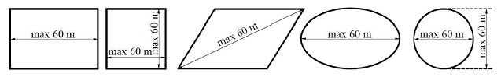

# Art. 8.1.12
(1) Dispunerea ecranelor coborâte sub acoperiș sau sub planșeul superior al spațiului protejat, în sistemul de evacuare prin tiraj natural-organizat, se realizează în funcție de prevederile normate, alcătuind rezervoare de fum. Rezervoarele de fum sunt separate prin bariere de fum minimum clasa DH 30 sau elemente constructive structurale cu rezistența la foc de minim 30 de minute. Limitele geometrice ale unui rezervor de fum pot fi date de toate elementele de construcții (pereți interiori sau exteriori opaci, elemente vitrate, grinzi sau ecrane etc.) care separă spațiul în zone de evacuare a fumului și a gazelor fierbinți. În toate situațiile, delimitările zonelor pentru care se efectuează calculul de evacuare a fumului, trebuie să fie cu minimum același timp de rezistență la foc și aceeași înălțime precum sunt definite în cazurile particulare din cadrul normativului.
(2) Ecranele continui se fixează de elementele de rezistență ale construcției din zona riscului potențial de incendiu.
(3) Lungimea maximă a rezervorului de fum de-a lungul oricărei axe nu va depăși 60 m (conform Figura 79).

  

  Figura 79 - Lungimea maximă a rezervorului de fum
