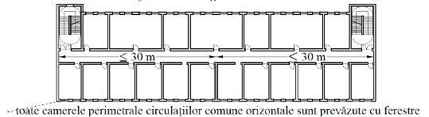
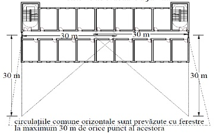
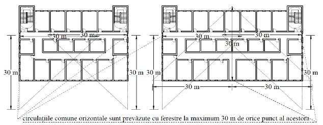
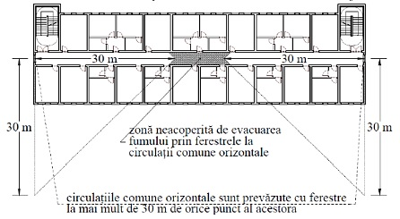
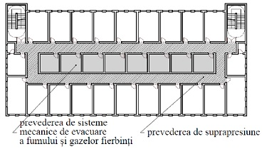
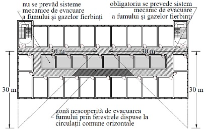

# Art. 8.1.8
(1) Sisteme pentru controlul fumului și gazelor fierbinți (evacuarea fumului și gazelor fierbinți: natural-organizată, mecanică sau mixtă, sau sisteme cu presiune diferențială (SPD) funcție de destinația și/sau tipul clădirii, încăperii sau spațiului) în caz de incendiu, se asigură la:
  - a) săli aglomerate;
  - b) scene cu suprafața mai mare de 150 mp și buzunarele acestora cu înălțimi mai mari de 10 m;
  - c) case de scări închise și încăperi tampon (prin suprapresiune) de acces la scări din clădirile supraterane civile înalte, foarte înalte și clădirile de sănătate (indiferent de regimul de înălțime), precum și puțurile ascensoarelor de evacuare a persoanelor cu dizabilități sau cu căruciorul și ascensoarelor pentru evacuarea bolnavilor cu căruciorul, cu targa sau cu patul cu rotile;
  - d) case de scări închise (prin suprapresiune sau cu evacuare natural-organizată prin trape și admisie de aer conform prevederi normate) și circulații comune orizontale care nu au ferestre directe spre exterior prin care să se evacueze fumul în caz de incendiu, din clădiri/compartimente de incendiu cu săli aglomerate;
  - e) case de scări închise supraterane, inclusiv cele care au ferestre direct spre exterior și asigură evacuarea utilizatorilor a mai mult de un nivel al clădirii și case de scări închise subterane, inclusiv cele care au ferestre deschizibile direct spre exterior, cu evacuare natural-organizată prin trape și admisie de aer conform prevederi normate (atunci când nu sunt prevăzute cu SPD);
  - f) case de scări închise dispuse în clădiri subterane, inclusiv cele care au ferestre deschizibile direct spre exterior, cu evacuare natural-organizată prin trape și admisie de aer conform prevederi normate (atunci când nu sunt prevăzute cu SPD);
  - g) atriumuri închise, conform prevederi normate;
  - h) degajamente protejate sau tuneluri pentru evacuarea utilizatorilor din construcții cu orice destinație (prevăzute cu sistem pentru evacuarea fumului și gazelor fierbinți în caz de incendiu sau prin suprapresiune) sau din încăperi tampon;
  - i) încăperi, compartimente și clădiri de producție și/sau depozitare cu aria utilă mai mare de 36 mp și cu densitatea sarcinii termice mai mare de 105 MJ/mp;
  - j) încăperi de depozitare a materialelor și/sau a substanțelor combustibile, din clădiri civile, cu densitatea sarcinii termice (q) peste 105 MJ/mp și aria utilă mai mare de 36 mp;
  - k) parcaje pentru autovehicule subterane, potrivit reglementării tehnice specifice, iar la cele supraterane, conform dispozițiilor normativului;
  - l) parcaje deschise conform Art. 3.2.11.21 alin. (3);
  - m) încăperi cu risc foarte mare de incendiu situate în subteran, indiferent de aria lor;
  - n) încăperi cu aria utilă mai mare de 36 mp și densitatea de sarcină termică mai mare de 105 MJ/mp situate în subteran;
  - o) încăperi din clădirile civile subterane în care se pot afla simultan mai mult de 50 de utilizatori și căile lor de evacuare prin care se pot evacua simultan mai mult de 50 de utilizatori, precum și la spațiile comerciale amenajate în subsolurile clădirilor supraterane cu mai mult de 50 de utilizatori, inclusiv a căilor de evacuare închise aferente acestora prin care se pot evacua simultan mai mult de 50 de utilizatori;
  - p) circulații comune orizontale cu lungimea mai mare de 30 m care nu au ferestre direct spre exterior prin care să se evacueze fumul în caz de incendiu (amplasate astfel încât să asigure evacuarea fumului și gazelor fierbinți în caz de incendiu pe maximum 30 m adâncime a circulațiilor comune orizontale), atunci când încăperile adiacente nu sunt prevăzute cu ferestre sau evacuări de fum prin sistem natural-organizat sau mecanic. Atunci când încăperile adiacente sunt prevăzute cu ferestre sau cu sistem pentru evacuarea fumului și gazelor fierbinți în caz de incendiu, circulațiile comune orizontale nu mai necesită sisteme de evacuare a fumului și gazelor fierbinți în caz de incendiu;
  - q) circulații comune orizontale din clădiri înalte conform Art. 4.1.5.12. și din clădiri foarte înalte conform Art. 4.2.5.12.;
  - r) construcții supraterane închise de producție și/sau de depozitare, cu aria construită (Ac) de cel puțin 20.000 mp și lățimea mai mare de 72 m (încăperile, compartimentele de incendiu și construcțiile cu aria utilă mai mare de 36 mp și densitatea de sarcină termică mai mare de 105 MJ/mp);
  - s) construcții de producție și/sau depozitare supraterane închise cu aria construită (Ac) mai mare de 1.000 mp și în care activitatea se desfășoară numai la lumină artificială, cu acoperiș și pereți de închidere perimetrală plini, în care se prevăd numai goluri psihologice și uși de acces (încăperile, compartimentele de incendiu și construcțiile cu aria utilă mai mare de 36 mp și densitatea de sarcină termică mai mare de 105 MJ/mp);
  - t) alte construcții, încăperi și spații menționate în normativ.
  Note:
  - (1) Atunci când se prevăd cu sistem pentru evacuarea fumului si gazelor fierbinți în caz de incendiu, cu evacuare natural-organizată si admisie de aer conform prevederilor normate (cu excepția circulațiilor comune orizontale care au ferestre direct spre exterior prin care să se evacueze fumul în caz de incendiu, amplasate astfel încât să asigure evacuarea fumului și gazelor fierbinți în caz de incendiu pe maximum 30 m adâncime a circulațiilor comune orizontale), spațiile, încăperile, compartimentele de incendiu si/sau construcțiile nominalizate în normativ, evacuarea natural-organizată a fumului si gazelorfierbinți se realizează obligatoriu prin trape (orizontale sau verticale) certificate, care trebuie să îndeplinească condițiile normate.
  - (2) Prevederea sistemelor de evacuare a fumului si a gazelor fierbinți la circulații comune orizontale atunci când este necesară se va realiza în conformitate cu Figura 77.

Varianta a) atunci când încăperile adiacente sunt prevăzute cu evacuări de fum (natural organizat prin ferestre sau mecanic) circulațiile comune orizontale nu mai necesită prevederea de sisteme de evacuare a fumului

Varianta b) atunci când ferestrele circulațiilor comune orizontale sunt amplasate astfel încât să asigure evacuarea fumului și gazelor fierbinți în caz de incendiu pe maximum 30 m adâncime, circulațiile comune orizontale nu mai necesită prevederea de sisteme de evacuare a fumului

Varianta c) atunci când ferestrele circulațiilor comune orizontale sunt amplasate la mai mult de 30 m adâncime se prevede sistem mecanic de admisie a aerului și de evacuare a fumului și a gazelor fierbinți

Varianta d) atunci când încăperile care nu au ferestre direct în exterior prin care să se poată evacua fumul în caz de incendiu sunt prevăzute cu sistem mecanic de admisie si de evacuare a fumului si a gazelor fierbinți, circulațiile comune orizontale se pot pune în suprapresiune

Varianta e) atunci când ferestrele circulațiilor comune orizontale sunt amplasate la mai mult de 30 m adâncime iar încăperile care nu au ferestre direct în exterior prin care să se poată evacua fumul în caz de incendiu nu sunt prevăzute cu sistem mecanic de admisie si de evacuare a fumului si a gazelor fierbinți, circulațiile comune se echipează obligatoriu cu sistem mecanic de admisie si de evacuare a fumului si a gazelor fierbinți
Figura 77 - Prevederea sistemelor de control al fumului si a gazelor fierbinți la circulații comune orizontale
