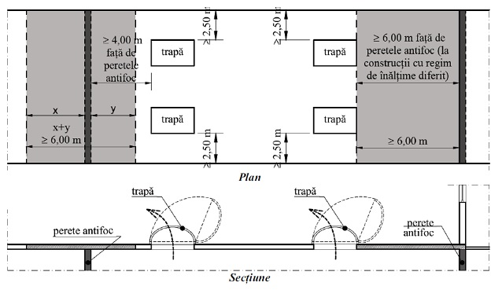

# Art. 8.4.6
(1) Ghenele verticale de evacuare a fumului în caz de incendiu, vor avea capetele exterioare prin care se evacuează fumul, amplasate la partea superioară a clădirilor sau a porțiunilor de clădiri supraterane respective. Elementele de construcție din jurul gurilor de evacuare a fumului (ghene verticale de evacuare a fumului și trape de evacuare a fumului) trebuie protejate/realizate cu/din produse pentru construcții având clasa de reacție la foc A1 sau A2-s1,d0 pe o distanță de cel puțin:
  - a) 2 m lateral (de jur împrejur) când sunt instalate în acoperiș;
  - b) 1 m lateral (de jur împrejur) și minimum 2 m deasupra, când se amplasează în pereții exteriori.
(2) Între prizele de aer proaspăt și capetele exterioare ale ghenelor de evacuare a fumului, se asigură distanțe de minimum 8 m (măsurată pe orizontală). Capetele ghenelor de evacuare a fumului se amplasează astfel încât, pe cât posibil, vântul dominant să nu conducă fumul spre prizele de aer.
(3) Distanța de la marginea gurilor de evacuare a fumului dispuse în acoperișul construcțiilor, trebuie să fie (conform Figura 80) cel puțin:
  - a) 4 m față de pereți rezistenți la foc care separă compartimente de incendiu, în condițiile în care cele două compartimente de incendiu au același regim de înălțime;
  - b) 2,5 m față de pereții exteriori;
  - c) 6 m față de pereți exteriori cu suprafețe vitrate fără rezistență la foc ai unei porțiuni de clădire/clădire adiacentă, mai înalte/nivel retras, dacă aceasta nu se constituie ca și compartiment distinct de incendiu (în situația comasării clădirilor) sau față de pereți rezistenți la foc care separă compartimente de incendiu în condițiile în care cele două compartimente de incendiu au regim de înălțime diferit;

  

  Figura 80 - Amplasarea în acoperișul/pe terasa construcțiilor a
  dispozitivelor de evacuare a fumului și gazelor fierbinți
