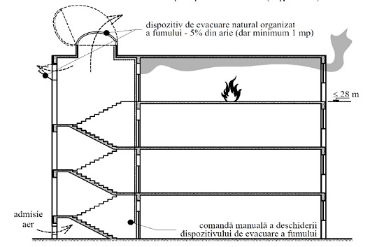

# Art. 8.5.1
(1) Scările supraterane închise care asigură evacuarea utilizatorilor se prevăd cu sistem de evacuare a fumului în caz de incendiu prin tiraj natural-organizat sau se pun în suprapresiune.
(2) Evacuarea fumului și gazelor fierbinți prin tiraj natural-organizat a caselor de scări supraterane închise, se realizează prin deschiderea automată în caz de incendiu a dispozitivului de evacuare a fumului (amplasat în perete la ultimul nivel al casei scării sau în acoperișul acesteia) și a gurii de admisie a aerului prevăzută la partea ei inferioară (la nivelul căii de acces din exterior). Dispozitivele cu deschidere automată vor avea și acționări manuale (Figura 81).

  

  Figura 81 - Evacuarea fumului din casele de scări închise supraterane
  asigurată prin tiraj natural (principiul nu se aplică la casele de scări închise prevăzute cu suprapresiune)
