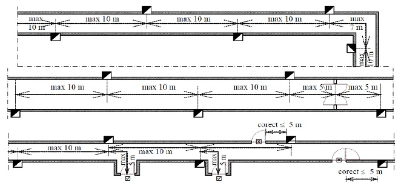

# Art. 8.5.4
(1) Evacuarea fumului și gazelor fierbinți în caz de incendiu prin tiraj natural- organizat a circulațiilor comune orizontale închise din construcții, va respecta următoarele condiții:
  - a) gurile de admisie a aerului și gurile de evacuare a fumului se dispun alternat, la distanțe orizontale măsurate în axele circulațiilor respective, care să nu depășească 10 m în linie dreaptă sau 7 m în linie frântă (Figura 82);
  - b) ușile încăperilor accesibile utilizatorilor, situate pe o cale de evacuare care nu se află între o gură de introducere aer și o gură de evacuare fum, este recomandabil să se găsească la cel mult 5 m de oricare din ele;
  - c) gurile de introducere și cele de evacuare a fumului vor avea arii de minimum 0,1 mp pentru fiecare unitate de trecere (flux) de evacuare a circulației comune orizontale din zona care se prevede cu sisteme de evacuare a fumului și a gazelor fierbinți.

  

  Figura 82 - Evacuarea fumului și gazelor fierbinți în caz de incendiu din
  circulațiile comune orizontale, prin tiraj natural-organizat
(2) Golurile din pereții de închidere perimetrală ai construcției pot constitui guri de introducere a aerului sau de evacuare a fumului, dacă respectă condițiile de dispunere, acționare și dimensionare stabilite în normativ și în reglementările tehnice de specialitate
