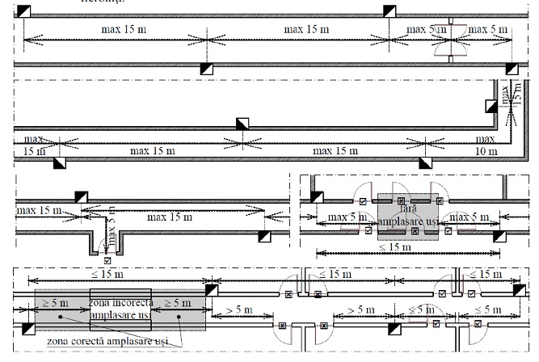

# Art. 8.5.5
Evacuarea fumului și gazelor fierbinți în caz de incendiu prin ventilare mecanică a circulațiilor comune orizontale închise din construcții, va respecta următoarele condiții (Figura 83):
a) gurile de admisie a aerului și gurile de evacuare a fumului se dispun alternat, la distanțe orizontale măsurate în axele circulațiilor respective, care să nu depășească 15 m în linie dreaptă și 10 m în linie frântă;
b) ușile încăperilor accesibile utilizatorilor, situate pe o cale de evacuare care nu se află între o gură de introducere aer și o gură de evacuare fum, este recomandabil să se găsească la cel mult 5 m de oricare din ele;
c) porțiunile de circulație comună orizontală cuprinse între o gură de admisie a aerului și o gură de evacuare a fumului, trebuie să aibă asigurat un debit de extragere (la gură) de minimum 0,5 mc/s pentru fiecare unitate de trecere (flux) de evacuare a circulației comune orizontale din zona care se prevede cu sistem de evacuare a fumului și gazelor fierbinți.

Figura 83 - Evacuarea fumului și gazelor fierbinți în caz de incendiu
din circulațiile comune orizontale, prin ventilare mecanică
